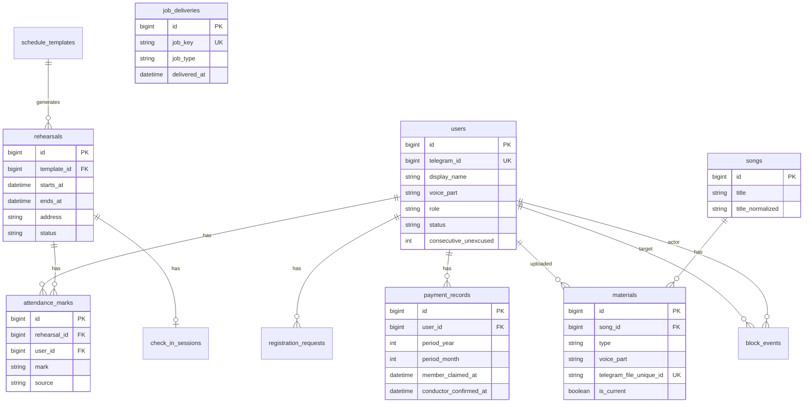

# Схема базы данных

Схема рассчитана на **MySQL 8+** (production на shared hosting) и **SQLite 3** (локальная разработка). Эталон DDL: [schema.sql](schema.sql). **Применение в коде:** SQL-файлы в каталоге `migrations/mysql/` и `migrations/sqlite/` (runner — `public/admin/migrate.php`). Миграция `002_*` — роль `admin` вместо `helper`, `voice_part` допускает `NULL` до выбора партии. Миграция `003_*` — роль `owner`. Миграция `004_*` — журнал `block_events`. Миграция `005_*` — `user_flows`, индекс слотов, seed шаблонов.

## Соглашения

- Время хранится в UTC (`DATETIME` / ISO-8601 текст в SQLite) или как `TIMESTAMP` с приложением, переводящим в `Asia/Almaty` при cron и отображении.
- Telegram ID — `BIGINT` (MySQL) / `INTEGER` (SQLite).
- Перечисления — `VARCHAR` + CHECK (SQLite) или ENUM (MySQL); в portable DDL используются строковые коды.

## Таблицы

### `users`

Участники, помощники, дирижёр и **owner** (создатель бота, `OWNER_TELEGRAM_ID`). Дирижёр в БД — не более одной записи с `role=conductor` (назначает owner). Опционально `CONDUCTOR_TELEGRAM_ID` в `.env` для legacy-автоназначения при первом действии.

| Колонка | Тип | Описание |
|---------|-----|----------|
| `id` | PK | Внутренний id |
| `telegram_id` | UNIQUE, NOT NULL | Telegram user id |
| `display_name` | VARCHAR(255) | Имя в хоре |
| `voice_part` | VARCHAR(32) NULL | Партия; `NULL` до завершения регистрации |
| `role` | VARCHAR(16) | `member`, `admin`, `conductor`, `owner` |
| `status` | VARCHAR(16) | `pending`, `active`, `blocked`, `rejected` |
| `consecutive_unexcused` | INT DEFAULT 0 | Счётчик подряд неуважительных |
| `created_at` | DATETIME | |
| `updated_at` | DATETIME | |

### `registration_requests`

Активная заявка на регистрацию (для уведомления админов и кнопок Accept/Reject).

| Колонка | Тип | Описание |
|---------|-----|----------|
| `id` | PK | |
| `user_id` | FK → users | |
| `status` | VARCHAR(16) | `pending`, `accepted`, `rejected` |
| `admin_message_id` | BIGINT NULL | id сообщения в чате админа (опционально) |
| `created_at` | DATETIME | |
| `resolved_at` | DATETIME NULL | |

### `schedule_templates`

Шаблон расписания (2 дня в неделю по умолчанию).

| Колонка | Тип | Описание |
|---------|-----|----------|
| `id` | PK | |
| `weekday` | TINYINT | 1=пн … 7=вс (ISO) |
| `start_time` | TIME | Локальное Asia/Almaty |
| `duration_minutes` | INT | Длительность репетиции |
| `address` | VARCHAR(512) | |
| `is_active` | BOOLEAN | |
| `sort_order` | INT | |

### `rehearsals`

Конкретные экземпляры репетиций.

| Колонка | Тип | Описание |
|---------|-----|----------|
| `id` | PK | |
| `template_id` | FK NULL | NULL для внеплановых |
| `starts_at` | DATETIME | Начало (UTC или локальное + TZ в приложении — единообразно в коде) |
| `ends_at` | DATETIME | Конец (для окна check-in) |
| `address` | VARCHAR(512) | Может переопределять шаблон |
| `status` | VARCHAR(16) | `scheduled`, `cancelled`, `completed` |
| `created_at` | DATETIME | |
| `updated_at` | DATETIME | |

### `attendance_marks`

Итоговая отметка по паре (user, rehearsal).

| Колонка | Тип | Описание |
|---------|-----|----------|
| `id` | PK | |
| `rehearsal_id` | FK | |
| `user_id` | FK | |
| `mark` | VARCHAR(16) | `attended`, `warned`, `unexcused`, `excused_manual` |
| `source` | VARCHAR(32) | `check_in`, `day_before`, `manual`, `absence_button`, `system` |
| `reason_text` | TEXT NULL | Причина (если была) |
| `marked_at` | DATETIME | |
| UNIQUE | (`rehearsal_id`, `user_id`) | |

### `check_in_sessions`

Состояние активного опроса check-in (опционально, для редактирования сообщений).

| Колонка | Тип | Описание |
|---------|-----|----------|
| `id` | PK | |
| `rehearsal_id` | FK UNIQUE | |
| `started_at` | DATETIME | |
| `closed_at` | DATETIME NULL | |

### `payment_records`

Оплата за календарный месяц (год+месяц как период).

| Колонка | Тип | Описание |
|---------|-----|----------|
| `id` | PK | |
| `user_id` | FK | |
| `period_year` | SMALLINT | |
| `period_month` | TINYINT | 1–12 |
| `member_claimed_at` | DATETIME NULL | «Я оплатил(а)» |
| `conductor_confirmed_at` | DATETIME NULL | Подтверждение дирижёра |
| `confirmed_by_user_id` | FK NULL | Кто подтвердил |
| UNIQUE | (`user_id`, `period_year`, `period_month`) | |

### `songs`

| Колонка | Тип | Описание |
|---------|-----|----------|
| `id` | PK | |
| `title` | VARCHAR(255) | Название для поиска |
| `title_normalized` | VARCHAR(255) | Lowercase для поиска |
| `created_at` | DATETIME | |

### `materials`

Текущие и архивные материалы.

| Колонка | Тип | Описание |
|---------|-----|----------|
| `id` | PK | |
| `song_id` | FK | |
| `type` | VARCHAR(16) | `notes`, `translit`, `recording` |
| `voice_part` | VARCHAR(32) NULL | NULL для notes/translit; для recording — партия |
| `telegram_file_id` | VARCHAR(512) | |
| `telegram_file_unique_id` | VARCHAR(128) UNIQUE | Защита от дубликатов |
| `is_current` | BOOLEAN | Текущая версия (notes/translit) |
| `archived_at` | DATETIME NULL | |
| `uploaded_by_user_id` | FK | |
| `uploaded_at` | DATETIME | |
| `admin_chat_message_id` | BIGINT NULL | |

### `bot_settings`

Ключ–значение для настраиваемых дат оплаты, текстов и т.д.

| Колонка | Тип | Описание |
|---------|-----|----------|
| `setting_key` | PK VARCHAR(64) | |
| `setting_value` | TEXT | JSON или строка |

Значения по умолчанию (seed в [schema.sql](schema.sql)):

| `setting_key` | Значение | Смысл |
|---------------|----------|--------|
| `schedule_generation_weeks` | `4` | Горизонт автогенерации репетиций (недель) |
| `payment_reminder_day_1` | `23` | День первого напоминания об оплате |
| `payment_reminder_day_2` | `1` | День второго напоминания |
| `payment_reminder_hour` | `12` | Час напоминаний (Asia/Almaty) |
| `rehearsal_default_duration_minutes` | `120` | Длительность репетиции по умолчанию |

### `user_flows`

Временное состояние пошаговых админ-диалогов (перенос репетиции, шаблоны).

| Колонка | Тип | Описание |
|---------|-----|----------|
| `telegram_id` | PK | |
| `flow` | VARCHAR(32) | Код сценария |
| `context` | TEXT | JSON |
| `updated_at` | DATETIME | |

Уникальный индекс `rehearsals(template_id, starts_at)` — защита от дублей автогенерации.

### `block_events`

Журнал блокировок и разблокировок.

| Колонка | Тип | Описание |
|---------|-----|----------|
| `id` | PK | |
| `target_user_id` | FK → users | Кого заблокировали/разблокировали |
| `actor_user_id` | FK NULL → users | Кто выполнил (`NULL` при `reason=auto`) |
| `action` | VARCHAR(16) | `block`, `unblock` |
| `reason` | VARCHAR(16) | `manual`, `auto` |
| `created_at` | DATETIME | |

При ручной разблокировке у участника обнуляется `users.consecutive_unexcused`.

### `job_deliveries`

Идемпотентность фоновых рассылок.

| Колонка | Тип | Описание |
|---------|-----|----------|
| `id` | PK | |
| `job_key` | VARCHAR(191) UNIQUE | См. scenarios.md |
| `job_type` | VARCHAR(64) | |
| `related_id` | BIGINT NULL | rehearsal_id, user_id, … |
| `delivered_at` | DATETIME | |
| `payload_hash` | VARCHAR(64) NULL | Опционально |

## ER-диаграмма

## Индексы (рекомендуемые)

- `rehearsals(starts_at, status)` — предстоящие репетиции и cron.
- `attendance_marks(user_id, marked_at)` — история и месячная сводка.
- `materials(song_id, type, voice_part, is_current)` — выдача участникам.
- `songs(title_normalized)` — поиск.

## Отличия SQLite

См. комментарии в [schema.sql](schema.sql): `AUTO_INCREMENT` → `AUTOINCREMENT`, `BOOLEAN` → `INTEGER`, `ENUM` не используется, `BIGINT` для telegram_id остаётся INTEGER.

## Открытые вопросы (зафиксированы для реализации)

1. Автоматическая **блокировка** при 4-м unexcused — `MemberBlockService::blockAuto()` (журнал `reason=auto`).
2. **Отклонение** заявки: статус `rejected` vs удаление пользователя — используется `rejected`.
3. **Дирижёр в БД**: назначение owner; legacy `CONDUCTOR_TELEGRAM_ID` — автосинхронизация при первом действии.
